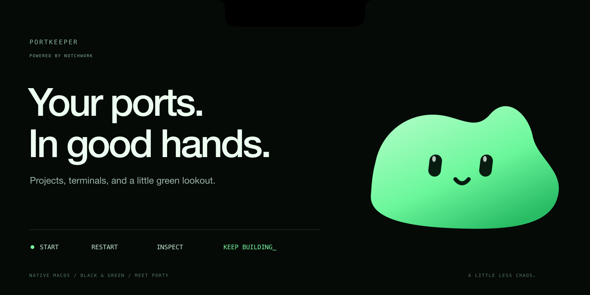

# Your ports. In good hands.

Portkeeper keeps your local projects, services, and terminals close. Start a project, restart a stubborn worker, find what owns a port, or hand an error to your coding assistant. Porty—the little green blob—keeps watch from the notch.

**macOS 14+ · Apple silicon · Native SwiftUI · Powered by [Notchwork](https://github.com/jesseglab/notchwork)**

[Download v1.3.0](https://github.com/jesseglab/portkeeper/releases/tag/v1.3.0) · [Get started](#get-started) · [Use with Notchwork](#one-app-two-homes) · [Full guide](docs/GUIDE.md)

## Less hunting. More building.

| What you need | What Portkeeper does |
| --- | --- |
| A project back on its feet | Start, stop, or restart its managed services in order. |
| A port explained | Show the listener, its owner, and the configured service. |
| A terminal within reach | Pin managed consoles to the edge drawer; search output and send input. |
| Context for your assistant | Copy diagnostic prompts with common credentials redacted. |
| A new project added | Paste JSON, review its commands, then import or start. |

Service controls operate on Portkeeper-managed processes. Removing a console from view never stops its service. Quitting Portkeeper does stop managed services.

## One app, two homes

Portkeeper uses **[NotchworkKit](https://github.com/jesseglab/notchwork)** as a Swift package dependency. Its native notch and terminal drawer use Notchwork's surface engine; Portkeeper supplies the layouts, Porty, terminal views, project actions, and AI tools. There is no second copy of the surface engine to keep in sync.

**Use Portkeeper on its own.** Its native interface lives around the notch, with an active-terminal drawer on the right. On a screen without a notch, it uses a top-center tab. The standalone Notchwork host is optional.

**Use it in the shared Notchwork host.** Enable **Share service status with Notchwork** in Portkeeper, enable **Portkeeper** in Notchwork's live integrations, then allow **Custom UI** for Portkeeper under Connected apps. Assign its source to your preferred slots and drawers.

Portkeeper brings its own black-and-green panel, Porty icon, service states, and start/stop/restart controls into the host. Project restart remains available. **Terminals, project handoff & AI** opens the full native Portkeeper interface. If Custom UI is off, Notchwork shows a standard status card instead.

The shared panel sends named actions back to Portkeeper, which validates each service or project before performing it. It does not send arbitrary shell commands. Commands, paths, logs, and diagnostic contents stay in Portkeeper. Enable **Allow priority** if you want service errors to temporarily take a notch slot.

## Meet Porty


Porty is calm when everything is quiet, looks up during startup, and reacts when a service needs you. The native face blinks occasionally and changes expression with status. The shared panel has its own lightweight CSS rendition; the compact host slot uses the bundled Porty icon. These are designed for small surfaces, not continuous decorative animation.

## Smooth when it moves. Quiet when it rests.

Notchwork handles the spring motion and curved surfaces. Reversing a hover preserves momentum; the window stays stationary while its shape changes. Native hidden content detaches, and animation stops at rest. Reduce Motion is respected.

Portkeeper batches service output, bounds pending data, and prevents overlapping port scans. The shared bridge coalesces status changes and the host watches a local snapshot instead of repeatedly scanning files. Custom UI exists only with your permission and its page clears when the surface detaches. Resource use still depends on the number of services and their output.

## Get started

Download the Apple silicon development build from the release page, or build from source with macOS 14+ and Xcode’s Swift toolchain:

```sh
git clone https://github.com/jesseglab/portkeeper.git
cd portkeeper
zsh build.sh
open dist/Portkeeper.app
```

The build produces `dist/Portkeeper.app` and `dist/Portkeeper.zip`, including Notchwork's license notices. The SDK is linked into Portkeeper; users do not need to install it separately. The host app is required only for shared-host mode. The dependency is pinned to Notchwork **0.1.0**. For SDK development, set `NOTCHWORK_PACKAGE_PATH=/path/to/notchwork` explicitly.

Builds are ad-hoc signed and not notarized; macOS may block downloaded binaries. No services start automatically. Configurations and logs live in `~/Library/Application Support/Portkeeper/`. Updating a running Portkeeper requires quitting it first, which stops its managed services.

## For developers

- [Feature guide and terminal behavior](docs/GUIDE.md)
- [Notchwork: host, API, and Swift SDK](https://github.com/jesseglab/notchwork)
- [Portkeeper's custom shared panel](Sources/PortkeeperNotchworkUI.swift)
- [The typed bridge and action handlers](Sources/NotchworkBridge.swift)
- [Dependency license notices](THIRD_PARTY_NOTICES.md)

Run `NOTCHWORK_PACKAGE_PATH=/path/to/notchwork zsh Tests/run.sh` in a graphical Mac session. The suite uses isolated preferences and temporary services, including real input, restart, output delivery, shared-panel actions, and native surface motion. The existing app is not relaunched by the tests.

NotchworkKit is licensed under **PolyForm Noncommercial 1.0.0**. This dependency does not grant commercial-use rights; commercial distribution requires separate permission. See the dependency's [license](https://github.com/jesseglab/notchwork/blob/main/LICENSE) and the bundled notices.

---

A little less chaos. A little more green.

## Clean checkout

Portkeeper ships with no configured projects, ports, logs, or personal preferences. Service settings stay in the current macOS user’s Application Support folder; interface preferences stay in that user’s preferences. Tests and optional previews use explicitly synthetic fixtures. The handoff brief contains placeholders to fill from your own project.
