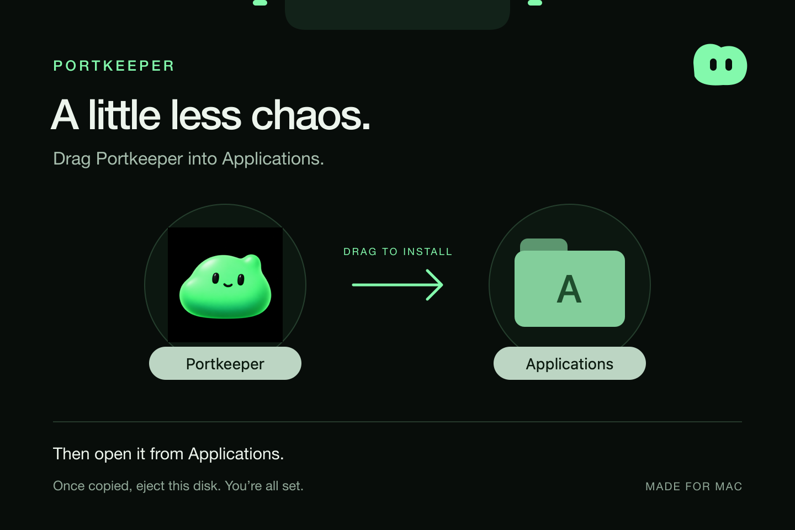

# Your ports. In good hands.

Portkeeper keeps your local projects, services, and terminals close. Start a project, restart a stubborn worker, find what owns a port, or hand an error to your coding assistant. Porty—the little green blob—keeps watch from the notch.

**macOS 14+ · Apple silicon · Powered by [Notchwork](https://github.com/jesseglab/notchwork)**

[Releases](https://github.com/jesseglab/portkeeper/releases) · [Get started](#get-started) · [Use with Notchwork](#one-app-one-shared-notch) · [Full guide](docs/GUIDE.md)

> **Current development version:** the default branch contains **1.3.3, build 11**, using the shared Notchwork runtime. The downloadable **v1.3.1** release predates this change. Build both repositories below for the current version.

## Less hunting. More building.

| What you need | What Portkeeper does |
| --- | --- |
| A project back on its feet | Start, stop, or restart its managed services in order. |
| A port explained | Show the listener, its owner, and the configured service. |
| A terminal within reach | Open managed consoles in the notch; search output, send input, or detach a terminal. |
| Context for your assistant | Copy diagnostic prompts with common credentials redacted. |
| A new project added | Paste JSON, review its commands, then import or start. |

Service controls operate on Portkeeper-managed processes. Removing a console from view never stops its service. Quitting Portkeeper does stop managed services.

## One app, one shared notch

Portkeeper supplies the black-and-green interface, Porty, service and project controls, editors, handoff tools, output, and active terminals. **[Notchwork](https://github.com/jesseglab/notchwork) supplies the container:** the notch window, placement, hover behavior, and morphing motion.

On first launch, Portkeeper reuses a compatible installed Notchwork or installs its verified bundled copy into your Applications folder. It starts the runtime in the background and connects automatically. Notchwork is a prerequisite; Portkeeper has no separate notch implementation.

Click the Portkeeper menu-bar item to open its interface. Service and project editors, handoff copy/save/import, import review, stop confirmations, output, and active terminal controls stay inside the shared notch. The full workspace and detached terminals remain available through their explicit buttons.

Notchwork settings let you give Portkeeper the whole container in **One** mode, assign it a side in **Two**, or share space by priority in **Multiple**. Portkeeper reports issues as high, startup as mid, and healthy or idle status as low. Background updates never force the notch open.

Portkeeper validates and executes its own actions. Notchwork renders the supplied interface and returns named events; it does not run service commands. Selected editor and output content is passed to the local renderer when needed. App and Custom UI permissions remain under your control. [Runtime integration guide →](docs/NOTCHWORK.md)

## Meet Porty


Porty—the little green lookout—is part of Portkeeper’s own identity. Its bundled icon appears in the compact Notchwork container, alongside the app’s live status. Portkeeper supplies the artwork and interface; other apps can bring their own.

## Smooth when it moves. Quiet when it rests.

Notchwork handles the spring motion and curved container. Reversing a hover preserves momentum; the window stays stationary while its shape changes. Hidden content detaches, and animation stops at rest. Reduce Motion is respected.

Portkeeper batches service output, bounds pending data, and prevents overlapping port scans. The API bridge coalesces updates and reconnects when the host restarts. Live state updates preserve the open page, filter, and scroll position; editor drafts remain in Portkeeper. Resource use still depends on the number of services and their output.

## Get started

### Build the current version

Build from source with macOS 14+, Apple silicon, and Xcode’s Swift toolchain. Clone the current development branches side by side:

```sh
git clone https://github.com/jesseglab/notchwork.git
git clone https://github.com/jesseglab/portkeeper.git
cd portkeeper
zsh build.sh
open dist/Portkeeper.app
```

The build produces `dist/Portkeeper.app` and `dist/Portkeeper.zip`, including the matching Notchwork runtime and its license notices. It uses the sibling Notchwork checkout; set `NOTCHWORK_PACKAGE_PATH` to use another local checkout. `NOTCHWORK_RUNTIME_APP_PATH` can point to an already-built matching runtime, which is signature-checked before bundling.

Portkeeper requires **Notchwork 0.2.0 build 9 or newer**, with the `interface-forms` capability. First-run installation needs no administrator permission or network download. An incompatible existing destination is preserved and reported in settings; an older running runtime must quit before a newer version can take over. [Installation and compatibility details.](docs/NOTCHWORK.md)

Builds are ad-hoc signed and not notarized; macOS may block downloaded binaries. No services start automatically. Configurations and logs live in `~/Library/Application Support/Portkeeper/`. Updating a running Portkeeper requires quitting it first, which stops its managed services.

### Install a published release with drag and drop

The [v1.3.1 Apple silicon DMG](https://github.com/jesseglab/portkeeper/releases/download/v1.3.1/Portkeeper-1.3.1-arm64-development.dmg) remains available for the earlier version. It predates the required shared runtime; use the source build above for the current version.

1. Download the DMG and open it.
2. Drag **Portkeeper** onto **Applications** in the installer window.
3. Eject the disk, then open **Portkeeper** from Applications.



*Illustrated installer layout. Finder icons and colors follow your macOS appearance.*

The DMG is a drag-and-drop installer; it does not run scripts or start services. This development app is ad-hoc signed and not notarized, so macOS may block it on first launch. Packaging it as a DMG does not change that signing status.

## For developers

- [Feature guide and terminal behavior](docs/GUIDE.md)
- [Notchwork: host, API, and Swift SDK](https://github.com/jesseglab/notchwork)
- [Notchwork quickstart](https://github.com/jesseglab/notchwork/blob/main/docs/QUICKSTART.md) and [copyable LLM prompts](https://github.com/jesseglab/notchwork/blob/main/docs/LLM_PROMPTS.md)
- [Portkeeper’s interface](Sources/PortkeeperNotchworkUI.swift) and [page controllers](Sources/PortkeeperNotchworkPages.swift)
- [Verified runtime installation and reuse](Sources/NotchworkRuntime.swift)
- [Runtime integration guide](docs/NOTCHWORK.md)
- [The typed bridge and action handlers](Sources/NotchworkBridge.swift)
- [Dependency license notices](THIRD_PARTY_NOTICES.md)

Run `NOTCHWORK_PACKAGE_PATH=/path/to/notchwork zsh Tests/run.sh` in a graphical Mac session. The suite uses isolated preferences and temporary services, including real input, restart, output delivery, shared-interface actions, editors, handoff review, and WebKit navigation. The existing app is not relaunched by the tests.

Portkeeper is a reference integration; other clients do not need Portkeeper.

Notchwork and NotchworkKit are licensed under **PolyForm Noncommercial 1.0.0**. This dependency does not grant commercial-use rights; commercial distribution requires separate permission. See the dependency's [license](https://github.com/jesseglab/notchwork/blob/main/LICENSE) and the bundled notices.

---

A little less chaos. A little more green.

## Clean checkout

Portkeeper ships with no configured projects, ports, logs, or personal preferences. Service settings stay in the current macOS user’s Application Support folder; interface preferences stay in that user’s preferences. Tests and optional previews use explicitly synthetic fixtures. The handoff brief contains placeholders to fill from your own project.
